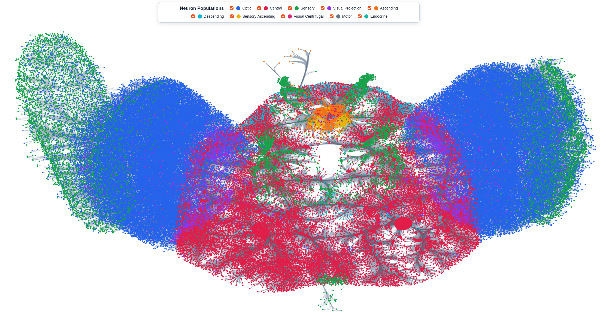
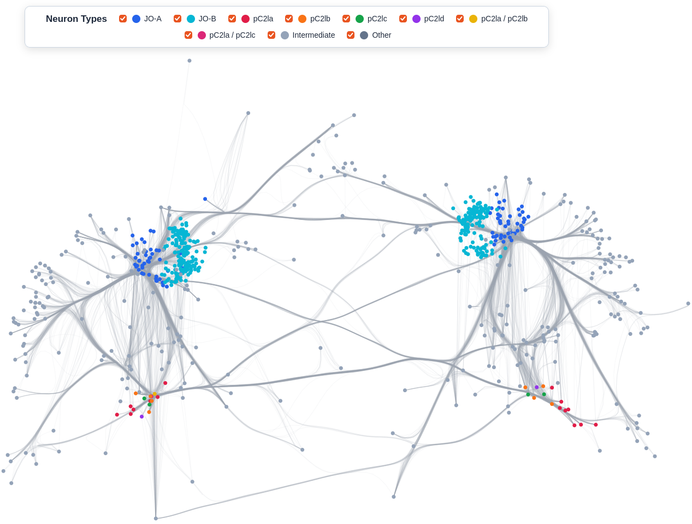
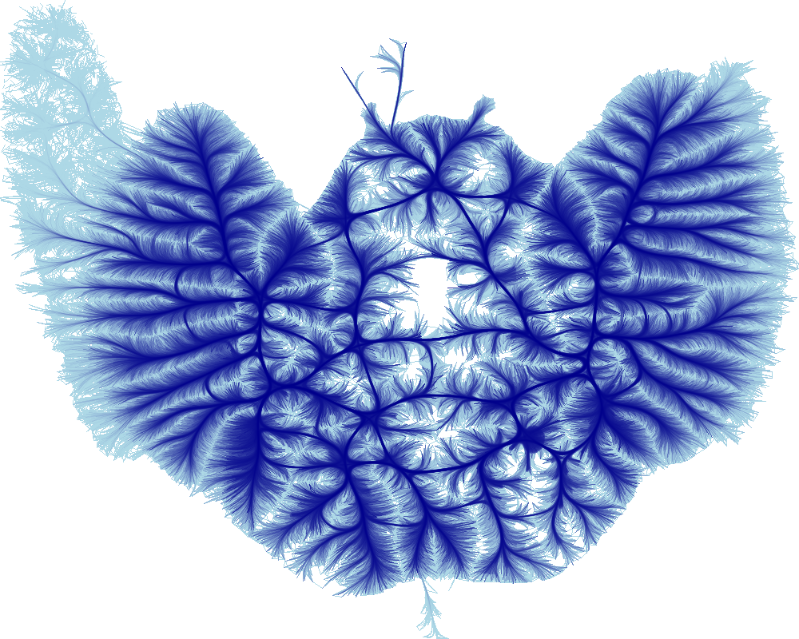
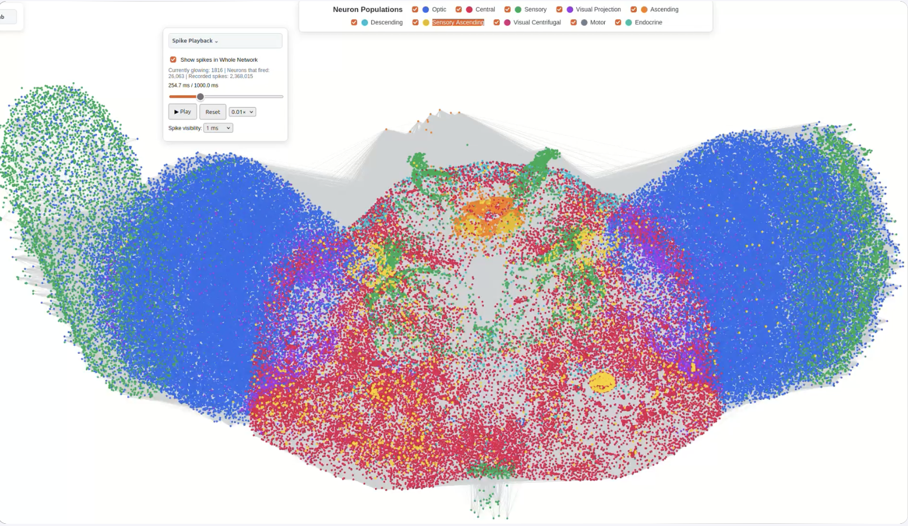

# FAFB: Female Adult Fly Brain

This project is for exploring the **FlyWire/FAFB connectome** at both whole-network and circuit scales. It combines network topology, straight and bundled connections, neuron annotations, and time-resolved spike activity in one interface.

> **Project status:** Research prototype under active development.

## Demo and results


### Whole-network view



*Whole-network visualization with neurons colored by population.*

### Circuit view



*Selected JO-A/JO-B–pC2l circuit, with separate neuron-type filters.*

### Edge bundling



*Bundled connections provide an alternative to densely overlapping straight edges.*

### Spike playback



*Recorded spike events shown as solid highlights on firing neurons.*

**Video and images folder link:**

https://utsacloud-my.sharepoint.com/:f:/g/personal/sneha_karki_my_utsa_edu/IgAjppR45YaITbUYFYgjor7uAR9zWZiqPyAm8Rw2T46rirs?e=vuWa01


## Features

- **Whole Network Mode:** Explore the FAFB connectivity graph with neuron population colors and independent population visibility checkboxes.
- **Circuit Mode:** Focus on a JO-A/JO-B–pC2l circuit, including intermediate neurons, with neuron-type colors and filters.
- **Connections:** Switch between straight edges and edge-bundled representations.
- **Interactive navigation:** Pan and zoom with Sigma.js; inspect original available neuron properties by clicking a neuron.
- **Spike playback:** View recorded neuron firing activity over a 1-second simulation using playback controls, adjustable speed and visibility window. Whole-network and circuit views have separate spike visibility options.
- **Collapsible interface:** Independent network controls, neuron legends, and spike-playback panel.

## Dataset sizes in the current prototype

| Dataset/view | Neurons | Connections |
| --- | ---: | ---: |
| Whole FAFB network | 139,255 | 22,285,323 |
| Selected JO–pC2l circuit | 723 | 4,608 |

The simulation provides an ID mapping for approximately **138,639 neurons**. The supplied spike recording contains **2,368,015 spike events** from **26,063 distinct firing simulation neurons**. These spike totals describe the supplied recording, not necessarily the number of events matched to the displayed FAFB neurons.

## Technology stack

| Component | Technology |
| --- | --- |
| Frontend | TypeScript, Vite |
| Network interaction and node rendering | Graphology, Sigma.js |
| Large straight-edge rendering | Custom WebGL2 |
| Edge bundling and rasterization | Datashader (Python) |
| Backend API | Python, FastAPI |
| Data processing | pandas, Parquet, NumPy / Jupyter notebooks |

## How it works

1. **Preprocessing:** FlyWire neuron annotations and connectivity data are converted into formats suitable for visualization.
2. **Whole-network view:** Sigma.js renders neurons while a dedicated WebGL layer handles the large straight-edge dataset. A pre-rendered Datashader image is used for whole-network bundled edges.
3. **Circuit view:** A smaller Graphology graph displays the selected circuit; bundled edges are rendered from stored polyline paths.
4. **Spike playback:** Simulation neuron indices are mapped back to FlyWire neuron IDs and matched to the current view. Only neurons with recorded events inside the selected time window are highlighted.

## Project layout

```text
.
├── backend/
│   └── app.py
├── frontend/
│   ├── src/
│   │   ├── main.ts
│   │   ├── circuitMode.ts
│   │   ├── straightEdges.ts
│   │   ├── spikePlayback.ts
│   │   └── style.css
│   ├── index.html
│   └── package.json
├── scripts/                   # preprocessing notebooks/scripts
├── docs/
│   └── media/                  # screenshots and short demos
├── Data/                       # local research datasets (not committed)
├── README.md
└── .gitignore
```

## Running locally

### Requirements

- Python environment with project backend dependencies (including FastAPI, Uvicorn, and the data-reading libraries used by `backend/app.py`)
- Node.js and npm
- Locally available preprocessed FAFB and spike datasets

### 1. Start the backend

From the project root, activate your Python environment and run:

```bash
python -m uvicorn backend.app:app --reload --port 8003
```

### 2. Start the frontend

From a second terminal:

```bash
cd frontend
npm install
npm run dev
```

Open the local URL printed by Vite (usually `http://localhost:5173/`; it may use `5174` if `5173` is occupied).

### Data requirements

The current prototype reads locally preprocessed FlyWire data and UT San Antonio Computer Science Doctoral Student Johannes Bauer's simulation files, including:

```text
Data/
├── whole network/
│   ├── nodes_population.parquet
│   ├── straight_edges.bin
│   └── bundled_edges.parquet
├── jo circuit/
│   ├── jo_nodes.parquet
│   ├── jo_edges.parquet
│   └── jo_bundled.parquet
└── spike_data/
    └── spike_data/
        ├── id_to_idx.csv
        └── spike_data.json
```

Additional generated artifacts may be required by `backend/app.py` (for example, the bundled-edge image). **These large datasets are not included in this repository.** The backend must be configured with their correct local paths. This README does not provide an automated dataset download.

## Data and interpretation notes

- **Topology and connectivity** describe the network structure, while **spike playback** visualizes activity from a separate simulation recording.
- The spike ID mapping lists simulated neurons; **not every mapped neuron fired** during the recording.
- The spike display uses recorded events and an adjustable display window. Visualization alone does not establish that activity in one neuron caused activity in another.
- Displayed neuron properties are sourced from available dataset columns, rather than inferred from visual adjacency.


## Background

This is a product of LANCE Lab, a lab at the University of Texas at San Antonio, in the Computer Science Department focused in Neuromorphic Computing under the respected supervisor **Dr. William Severa**. 